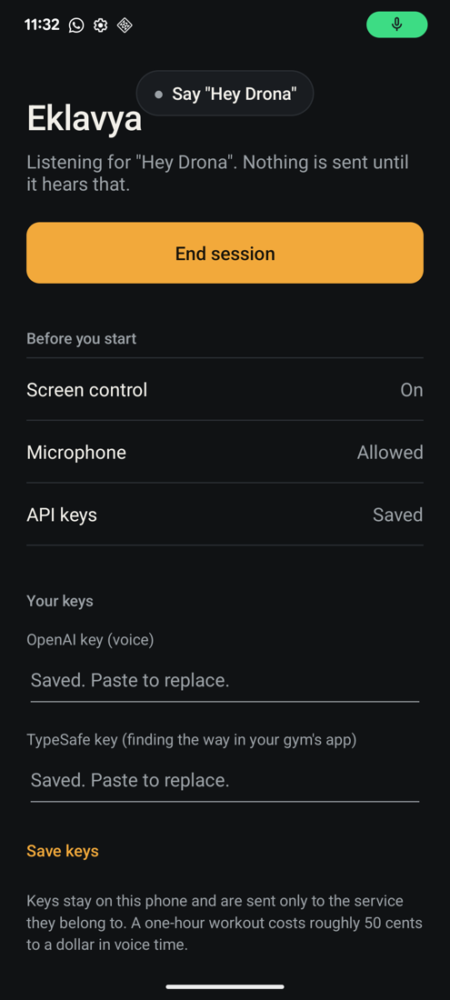

# Eklavya

A voice gym coach for Android that operates the fitness apps already on your
phone. With the phone on a tripod and your earphones in, you say "Hey Drona,
show me the video for pistol squat"; the coach answers, finds the exercise in
your gym's app and plays its demo.

The name is from the Mahabharata: Eklavya had no access to the teacher he
wanted, Drona, so he trained himself in front of a stand-in. Here you are
Eklavya, and the stand-in answers to "Drona".

| Start a session | The coach at work, over your gym's app | The demo page it finds | The demo playing |
| --- | --- | --- | --- |
|  |  |  |  |

Apart from the first screen and the small status pill, the screens are 24GO's
own. This is one spoken request on a Pixel 7a, from the app's log:

```text
23:31:13  a recording is played into the session: "Hey Drona, show me the video for pistol squat."
23:31:16  wake phrase heard
          user:  Show me the video for pistol squat
          coach: Sure, getting that up now.
23:31:20  tool   show_exercise_demo {"exercise":"pistol squat"}
23:31:21  went back 1 time(s) to start from the app's main screen
23:31:21  tap_1    (1.00)  tap [1] View "search box"
23:31:22  type_2   (0.59)  type "pistol squat" into [2] EditText "Search 1,969 Workouts and 250+ Demos"
23:31:23  submit_2 (0.97)  press the keyboard's search or enter key in [2] EditText "pistol squat"
23:31:24  tap_5    (0.99)  tap [5] CardView "Pistol Squat 1 minutes"
23:31:25  tap_16   (0.93)  tap [16] ViewGroup "Start Demo Exercise"
23:31:28  done     (1.00)  the task is already complete on this screen
          coach: The demo video is up. Watch the balance and knee tracking.
23:31:41  session closed, 24 s billed
```

## Features

- **A wake phrase heard on the phone.** Nothing is sent anywhere until the
  phone itself hears "Hey Drona".
- **A spoken exchange, then silence.** The coach listens and talks at the same
  time (OpenAI GPT-Live), and the connection closes a few seconds after the
  talk ends, because voice is billed by the second.
- **It works your gym's app for you.** A decision model (TypeSafe Jev) reads
  the screen as a short numbered list and picks one action at a time; an
  accessibility service carries it out.
- **It says when it cannot.** "I couldn't find one listed under lat pulldown"
  is what it says when the gym's app has no such demo.
- **It hands back anything that is yours to decide.** A screen asking for a
  payment, a booking or an account change stops the coach.
- **A status pill over the app in front,** readable from a few steps away;
  touches pass through it.

## Status

Early, and built for one person on one gym's app (24GO).

| Part | State |
| --- | --- |
| Reading and driving another app's screen (`screen/`, `a11y/`) | Works on a Pixel 7a (Android 16) |
| Finding the way with a decision model (`agent/`) | Works on the phone with Jev |
| Voice: wake phrase, spoken exchange, tool call, spoken result (`app/`) | Works on the phone when a recording is played into the session; not yet tried with a person speaking, with earbuds, or in a gym |
| What the coach can do | One thing: show an exercise's demo in 24GO |
| Planning a workout, logging sets to Hevy, camera rep counting | Not started |

### Voice, measured

Three recorded requests played into a running session on the phone,
2026-11-25:

| Request | What happened | Wake phrase to video | Voice billed |
| --- | --- | --- | --- |
| "…show me the video for pistol squat" | Demo playing; coach confirmed | 13 s | 24 s (about 2 cents) |
| "…can you show me the box squat?" | Demo playing; coach confirmed | 12 s | 22 s |
| "…show me how to do a lat pulldown" | Coach: none listed under that name | (10 s to the answer) | 24 s |

At about 2 cents an exchange, thirty exchanges in a workout cost about 60
cents of voice, plus well under a cent for the decision model.

The wake phrase was chosen by test. With synthesized voices, the untrained
keyword spotter caught "Hey Drona" in 16 clips out of 16, also with heavy
noise mixed in, and never fired on 12 near-miss sentences ("hey Rona", "hey
Donna", "drone"). It caught "Hey Eklavya" in none of 16. Real voices and real
gym noise are still to be tried.

### Decision models compared

The same sixteen decisions on recorded screens, asked of three models from a
laptop on 2026-11-25 (`./gradlew :agent:eval`):

| Model | Right | Median time per decision | Cost for all sixteen |
| --- | --- | --- | --- |
| TypeSafe Jev (`jev-latest`) | 15 of 16 | 0.07 s | $0.0010 |
| xAI `grok-4.20-0309-non-reasoning` | 15 of 16 | 0.59 s | $0.0249 |
| OpenAI `gpt-5-nano` | 13 of 16 | 6.5 s | $0.0077 |

A small set and one run each; earlier runs differed by a case or two per
model. Jev's one miss is a screen the navigator no longer asks it about.

## How it decides what to tap

The navigator first backs out to the app's main screen, so every request
starts from a known place. Then it reads the screen, offers the model every
action that exists on it ("tap [16] Start Demo Exercise", "type the exercise
name into [2]", "scroll [5] down", back, done, stuck) and carries out the one
it picks. The model never writes text or coordinates, so it cannot tap
something that is not there. Four rules sit outside the model's choice:

- Buttons that pay, book, post or unlock are never offered.
- Every decision also asks whether the screen wants a commitment (a payment,
  a booking, an account change). If so, the navigator stops and hands back.
- "Done" is offered only after the request has typed or tapped the thing
  asked for, so a video left playing by an earlier request cannot pass as
  the answer.
- Below 40% confidence the navigator stops and says what it was unsure about.

A screen reaches the model as a few numbered lines. Elements hidden under
something drawn on top are left out, and icon buttons without text are named
from their view id:

```text
app: io.a24go.android.dev | 1080x2400
[2] FrameLayout "Show player controls" clickable (540,446) #detailsVideo
[3] ImageButton "fab back" clickable (73,191) #fabBack
[8] TextView "Barbell Front Squat" clickable (540,961) #detailTitle
[13] TextView "1. Start with Barbell On Shoulders 2. Position Feet Shoulder Width ..." (540,1566)
[14] ViewGroup "Start Demo Exercise" clickable (540,2242) #ctaPrimaryActionView
```

## Quick start

Needs JDK 17 to 21, the Android SDK (platform 36, build tools 36.0.0), a phone
on Android 13 or later, an OpenAI API key and a TypeSafe API key.

```bash
./gradlew :screen:test :agent:test
```

```bash
./gradlew :app:installDebug
```

Then on the phone:

1. Open Eklavya and paste the two keys.
2. Tap "Turn on" next to Screen control and switch Eklavya on in Android's
   accessibility settings. On a sideloaded install Android greys the switch
   out until you open the app's info page and choose "Allow restricted
   settings" from the ⋮ menu.
3. Allow the microphone, then tap **Start session** and say "Hey Drona".

Debug builds also take commands from adb, and only from adb. `dump` prints
the screen as the model sees it, `nav` finds and plays a demo without voice,
and `hear` plays a recording into the running session as if it were spoken:

```bash
adb shell "am broadcast -a com.pragnyalabs.eklavya.DEBUG -p com.pragnyalabs.eklavya --es cmd nav --es arg 'pistol squat'"
```

```bash
adb logcat -s Eklavya
```

## Layout

- `screen/`: plain Kotlin, no Android classes. `Screen`, `UiNode` and
  `ScreenText`; real screens can be replayed from `adb shell uiautomator dump`
  files.
- `a11y/`: an Android library. `ScreenReader` copies the accessibility windows
  into a `Screen`; `ScreenDriver` taps, types, scrolls and waits for the
  screen to settle. Each action finds the live element again first and
  refuses to act if the screen has changed.
- `agent/`: plain Kotlin. `Navigator` works towards a goal one step at a time,
  asking a `Decider` (Jev, or any OpenAI-style chat endpoint) to choose.
  `AppNotes` holds what Eklavya knows about each app.
- `app/`: the app. `voice/` has the wake word (`WakeWord`), the GPT-Live
  connection (`LiveSession`), the microphone service (`CoachService`) and the
  coach's tools (`CoachTools`). `StatusOverlay` is the pill; `MainActivity`
  is the one screen. Design rules are in [DESIGN.md](DESIGN.md).
- `docs/REQUIREMENTS.md`: decisions and findings.

## What it stores and sends

- **Microphone.** While a session runs the phone listens for the wake phrase
  on the device. After it hears the phrase, audio goes to OpenAI until the
  exchange ends. Nothing is recorded or kept.
- **Screen.** An accessibility service can read everything on screen in every
  app. Eklavya reads only the gym app's windows, only while carrying out a
  request, and never copies the contents of password fields. That text
  (including your name if the app shows it) is sent to the decision model you
  chose: TypeSafe by default.
- **Keys.** Your API keys stay in the app's private storage on the phone and
  are sent only to the service they belong to.
- **Nothing else** leaves the phone, and there are no analytics. Release
  builds have no remote-control door; the debug commands exist only in debug
  builds and only for senders holding Android's `DUMP` permission (adb).

## Credits and licence

MIT. See [NOTICE.md](NOTICE.md) for third-party code, models and the origin of
the test fixtures.
