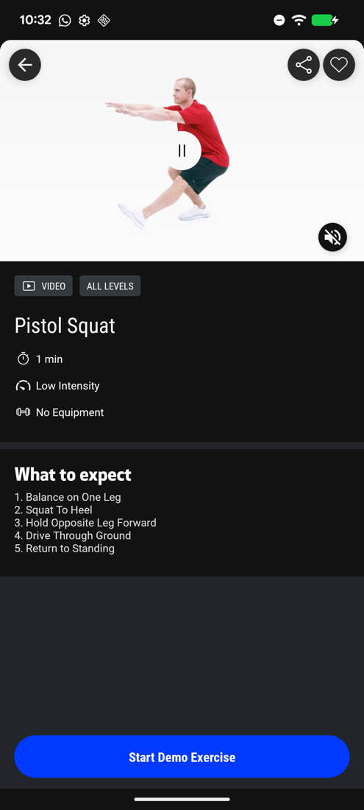
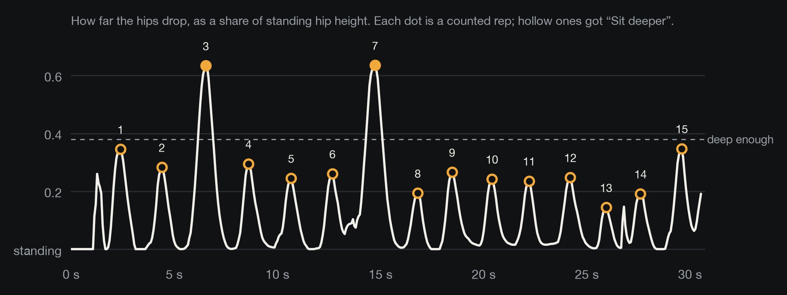

# Eklavya

A voice gym coach for Android that operates the fitness apps already on your
phone. With the phone on a tripod and your earphones in, you say "Hey Drona,
show me the video for pistol squat"; the coach answers, finds the exercise in
your gym's app and plays its demo. Say "Hey Drona, count my squats" and the
phone watches through its front camera, counts aloud and tells you what to
fix.

**Website:** [eklavya.pragnyalabs.com](https://eklavya.pragnyalabs.com/) (source in `site/`). There is
no download yet: you build the app from this repository.

The name is from the Mahabharata: Eklavya had no access to the teacher he
wanted, Drona, so he trained himself in front of a stand-in. Here you are
Eklavya, and the stand-in answers to "Drona".

| Start a session | The coach at work, over your gym's app | The demo page it finds | The demo playing |
| --- | --- | --- | --- |
|  |  |  |  |

Apart from the first screen and the small status pill, the screens are 24GO's
own. This is one spoken request on a Pixel 7a, from the app's log of
2026-11-26:

```text
01:10:37  a recording is played into the session: "Hey Drona, show me the video for pistol squat."
01:10:40  wake phrase heard
          user:  Hey Drona, show me the video for Pistol Squat
          coach: Sure.
01:10:45  tool   show_exercise_demo {"exercise":"Pistol Squat"}
01:10:47  went back 1 time(s) to start from the app's main screen
01:10:48  tap_1    (1.00)  tap [1] View "search box"
01:10:49  type_2   (0.55)  type "Pistol Squat" into [2] EditText "Search 1,969 Workouts and 250+ Demos"
01:10:50  submit_2 (0.96)  press the keyboard's search or enter key in [2] EditText "Pistol Squat"
01:10:51  tap_5    (0.99)  tap [5] CardView "Pistol Squat 1 minutes"
01:10:52  tap_16   (0.87)  tap [16] ViewGroup "Start Demo Exercise"
01:10:55  done     (1.00)  the task is already complete on this screen
01:11:03  session closed, 24 s billed
```

The coach says one word and lets the video be the answer.

## Counting a set

Ask for a count and the phone's front camera takes over. A pose model on the
phone finds your joints in each frame; from those it counts reps and checks a
few things a coach would look at. Counts and cues are spoken by the phone's
own voice, so no voice connection is open, or billed, while you lift.



That is one recorded set of shallow squats. Played through the pose model on
the phone, this is what the phone said, from the app's log:

```text
phone:  Ready.
phone:  1
phone:  2
phone:  Sit deeper.
phone:  3  4  5  6  7  8  9
phone:  Sit deeper.
phone:  10  11  12  13  14  15
phone:  Sit deeper.
        set over: 15 squats in 30 seconds. Form faults seen: "Sit deeper." on 13 of 15 reps.
phone:  15 reps. Next set, sit deeper.
```

And the spoken request that starts it, with nobody in front of the camera:

```text
01:07:17  a recording is played into the session: "Hey Drona, count my squats."
01:07:21  wake phrase heard
          user:  Hey, Drona, count my squats
          coach: Go ahead.
01:07:25  tool   count_reps {"exercise":"squats"}
01:07:25  camera: watching squats
01:07:29  session closed, 9 s billed
01:07:30  camera: 19.3 frames/s, pose 37 ms on the graphics chip, person not found
01:07:30  phone:  I can't see all of you. Step back.
```

Afterwards, "Hey Drona, how was my last set?" got: "Sure. Fifteen squats in
thirty seconds. Sit deeper: you missed depth on thirteen reps."

| Exercise | Stand | Counted from | Checked |
| --- | --- | --- | --- |
| Squat | Side on | How far the hips drop | Depth; chest dropping forward (side view); knees caving in (front view) |
| Bicep curl | Side on | How far the elbow bends | Swinging the torso; elbows drifting forward; stopping short at the top or bottom; dropping the weight fast |
| Shoulder press | Facing the phone | How high the wrists go | Stopping short of straight arms; one arm lower than the other |

A correction is said only for a fault seen on two reps running, at most once
every three reps, and the same one not again for six. The exercise is the one
you name; it is not recognised from the picture.

## Features

- **A wake phrase heard on the phone.** Nothing is sent anywhere until the
  phone itself hears "Hey Drona".
- **A spoken exchange, then silence.** The coach listens and talks at the same
  time (OpenAI GPT-Live), and the connection closes a few seconds after the
  talk ends, because voice is billed by the second.
- **It works your gym's app for you.** A decision model (TypeSafe Jev) reads
  the screen as a short numbered list and picks one action at a time; an
  accessibility service carries it out.
- **It counts your reps and corrects your form.** Squats, bicep curls and
  shoulder presses, through the front camera, with the pose model running on
  the phone: no picture is stored or sent.
- **Few words.** "Sure." and the video, not "I am opening the video".
- **It says when it cannot.** "I couldn't find one listed under lat pulldown"
  is what it says when the gym's app has no such demo.
- **It hands back anything that is yours to decide.** A screen asking for a
  payment, a booking or an account change stops the coach.
- **A status pill over the app in front,** readable from a few steps away;
  touches pass through it.

## Status

Early, and built for one person on one gym's app (24GO).

| Part | State |
| --- | --- |
| Reading and driving another app's screen (`screen/`, `a11y/`) | Works on a Pixel 7a (Android 16) |
| Finding the way with a decision model (`agent/`) | Works on the phone with Jev |
| Voice: wake phrase, spoken exchange, tool call, spoken result (`app/`) | Works on the phone when a recording is played into the session; not yet tried with a person speaking, with earbuds, or in a gym |
| Camera: rep counting and form cues for squats, curls and shoulder presses (`motion/`, `app/`) | Counts recorded sets correctly, on a laptop and through the pose model on the phone; the camera opens and runs with the app in the background. Not yet tried with a person in front of the phone |
| What the coach can do | Three things: show an exercise's demo in 24GO, count a set, report on the last set |
| Planning a workout, logging sets to Hevy | Not started |

### Voice, measured

Three recorded requests played into a running session on the phone,
2026-11-25 (an earlier run than the log above, which took 15 s):

| Request | What happened | Wake phrase to video | Voice billed |
| --- | --- | --- | --- |
| "…show me the video for pistol squat" | Demo playing; coach confirmed | 13 s | 24 s (about 2 cents) |
| "…can you show me the box squat?" | Demo playing; coach confirmed | 12 s | 22 s |
| "…show me how to do a lat pulldown" | Coach: none listed under that name | (10 s to the answer) | 24 s |

At about 2 cents an exchange, thirty exchanges in a workout cost about 60
cents of voice, plus well under a cent for the decision model.

The wake phrase was chosen by test. With synthesized voices, the untrained
keyword spotter caught "Hey Drona" in 16 clips out of 16, also with heavy
noise mixed in, and never fired on 12 near-miss sentences ("hey Rona", "hey
Donna", "drone"). It caught "Hey Eklavya" in none of 16. Real voices and real
gym noise are still to be tried.

Asking for a count costs less than asking for a video: 9 seconds billed,
because the exchange closes as soon as counting starts.

### Counting, measured

32 recorded sets of about 30 seconds each (four people; squats from the side
and the front, curls from the side, presses from the front), run through the
same pose model the phone uses, 2026-11-26:

- **Reps.** On 29 of the 32 the count equals an independent peak count of the
  raw signal. The other three start mid-rep or with the dumbbells being
  picked up, and there the peak count is one or two higher. In the two of
  those checked against the video frames the counter was right once (a set
  that opens with the person standing up out of a squat) and within one rep
  the other time (13 counted, 13 or 14 presses in the video).
- **Form.** All four curl sets labelled as bad form got a named fault
  (elbows drifting, lowering too fast, not straightening); none of the four
  labelled good did. The two squat sets that were plainly shallow were told
  "Next set, sit deeper"; no other squat set was. Two sets labelled good each
  got one cue mid-set (a "Sit deeper" after three shallower reps, a "Press
  all the way up"). The recordings do not say which fault each "bad" set
  shows, so this is as far as they can check the rules.
- **On the Pixel 7a.** The pose model takes about 37 ms a frame on the
  graphics chip, and the camera path runs at about 21 frames a second with
  another app in front. Three of the recorded sets played through the phone
  gave 15 squats with "Sit deeper", 6 curls with "Elbows by your sides" and
  13 presses.
- **Found on the way.** After someone bends towards the camera, pose tracking
  can lock on upside down and stay that way; the app notices and restarts it.
- **Not tested.** A person in front of the phone's own camera, a barbell or
  rack hiding joints, gym lighting, other people in the picture, and how the
  spoken counts sound (the phone was silenced for the overnight runs).

### Decision models compared

The same sixteen decisions on recorded screens, asked of three models from a
laptop on 2026-11-25 (`./gradlew :agent:eval`):

| Model | Right | Median time per decision | Cost for all sixteen |
| --- | --- | --- | --- |
| TypeSafe Jev (`jev-latest`) | 15 of 16 | 0.07 s | $0.0010 |
| xAI `grok-4.20-0309-non-reasoning` | 15 of 16 | 0.59 s | $0.0249 |
| OpenAI `gpt-5-nano` | 13 of 16 | 6.5 s | $0.0077 |

A small set and one run each; earlier runs differed by a case or two per
model. Jev's one miss is a screen the navigator no longer asks it about.

## How it decides what to tap

The navigator first backs out to the app's main screen, so every request
starts from a known place. Then it reads the screen, offers the model every
action that exists on it ("tap [16] Start Demo Exercise", "type the exercise
name into [2]", "scroll [5] down", back, done, stuck) and carries out the one
it picks. The model never writes text or coordinates, so it cannot tap
something that is not there. Four rules sit outside the model's choice:

- Buttons that pay, book, post or unlock are never offered.
- Every decision also asks whether the screen wants a commitment (a payment,
  a booking, an account change). If so, the navigator stops and hands back.
- "Done" is offered only after the request has typed or tapped the thing
  asked for, so a video left playing by an earlier request cannot pass as
  the answer.
- Below 40% confidence the navigator stops and says what it was unsure about.

A screen reaches the model as a few numbered lines. Elements hidden under
something drawn on top are left out, and icon buttons without text are named
from their view id:

```text
app: io.a24go.android.dev | 1080x2400
[2] FrameLayout "Show player controls" clickable (540,446) #detailsVideo
[3] ImageButton "fab back" clickable (73,191) #fabBack
[8] TextView "Barbell Front Squat" clickable (540,961) #detailTitle
[13] TextView "1. Start with Barbell On Shoulders 2. Position Feet Shoulder Width ..." (540,1566)
[14] ViewGroup "Start Demo Exercise" clickable (540,2242) #ctaPrimaryActionView
```

## Quick start

Needs JDK 17 to 21, the Android SDK (platform 36, build tools 36.0.0), a phone
on Android 13 or later, an OpenAI API key and a TypeSafe API key.

```bash
./gradlew :screen:test :agent:test :motion:test
```

```bash
./gradlew :app:installDebug
```

Then on the phone:

1. Open Eklavya and paste the two keys.
2. Tap "Turn on" next to Screen control and switch Eklavya on in Android's
   accessibility settings. On a sideloaded install Android greys the switch
   out until you open the app's info page and choose "Allow restricted
   settings" from the ⋮ menu.
3. Allow the microphone, and the camera if you want reps counted, then tap
   **Start session** and say "Hey Drona".
4. For a count, stand the phone at about hip height, two to three metres
   away, so that it sees you from head to feet.

Debug builds also take commands from adb, and only from adb. `dump` prints
the screen as the model sees it, `nav` finds and plays a demo without voice,
and `hear` plays a recording into the running session as if it were spoken.
`watch` counts a set through the camera without voice, and `watchfile`
counts the set in a video file:

```bash
adb shell "am broadcast -a com.pragnyalabs.eklavya.DEBUG -p com.pragnyalabs.eklavya --es cmd nav --es arg 'pistol squat'"
```

```bash
adb logcat -s Eklavya
```

## Layout

- `screen/`: plain Kotlin, no Android classes. `Screen`, `UiNode` and
  `ScreenText`; real screens can be replayed from `adb shell uiautomator dump`
  files.
- `a11y/`: an Android library. `ScreenReader` copies the accessibility windows
  into a `Screen`; `ScreenDriver` taps, types, scrolls and waits for the
  screen to settle. Each action finds the live element again first and
  refuses to act if the screen has changed.
- `motion/`: plain Kotlin. `SetTracker` turns a stream of body poses into
  counted reps, form cues and a set report; `RepCounter` follows the turning
  points of one number per exercise. Its tests replay recorded sets, and
  `./gradlew :motion:replay -Pposes=<folder>` prints what the coach would
  say for each recording in a folder.
- `agent/`: plain Kotlin. `Navigator` works towards a goal one step at a time,
  asking a `Decider` (Jev, or any OpenAI-style chat endpoint) to choose.
  `AppNotes` holds what Eklavya knows about each app.
- `app/`: the app. `voice/` has the wake word (`WakeWord`), the GPT-Live
  connection (`LiveSession`), the microphone service (`CoachService`) and the
  coach's tools (`CoachTools`). `camera/SetWatcher` feeds camera frames
  through the pose model to a `SetTracker` and speaks what it reports.
  `StatusOverlay` is the pill; `MainActivity`
  is the one screen. Design rules are in [DESIGN.md](DESIGN.md).
- `site/`: the website, plain HTML and CSS with no build step. Its design rules are in
  `site/DESIGN.md`.
- `tools/`: two Python scripts: one turns exercise videos into the pose recordings the tests
  replay, the other draws the squat-depth chart above.
- `docs/REQUIREMENTS.md`: decisions and findings.

## What it stores and sends

- **Microphone.** While a session runs the phone listens for the wake phrase
  on the device, and nothing is sent until it hears it. When it does, audio
  goes to OpenAI until the exchange ends, starting with the 2.5 seconds
  before the phrase was recognised: that is the phrase itself and whatever
  was said just before it. Nothing is recorded or kept.
- **Camera.** Used only while a set is being counted. Each frame goes
  through a pose model on the phone and is then dropped: no picture or
  video is stored, and none leaves the phone. Only the result (reps and
  faults) is kept: by the app until the session ends, and in Android's
  system log on the phone. It reaches OpenAI only if you ask the coach about
  your last set.
- **Screen.** An accessibility service can read everything on screen in every
  app. Eklavya reads only the gym app's windows, only while carrying out a
  request, and never copies the contents of password fields. That text
  (including your name if the app shows it) is sent to the decision model you
  chose: TypeSafe by default.
- **Keys.** Your API keys stay in the app's private storage on the phone and
  are sent only to the service they belong to.
- **Nothing else** leaves the phone, and there are no analytics. Release
  builds have no remote-control door; the debug commands exist only in debug
  builds and only for senders holding Android's `DUMP` permission (adb).

## How it is deployed

The app is not published anywhere; it is installed from a build. The website is static files
served by nginx at `eklavya.pragnyalabs.com`: `rsync` of `site/` (without `DESIGN.md` and
`og.html`) to the server's `/var/www/eklavya`.

## Credits and licence

MIT. See [NOTICE.md](NOTICE.md) for third-party code, models and the origin of
the test fixtures.
