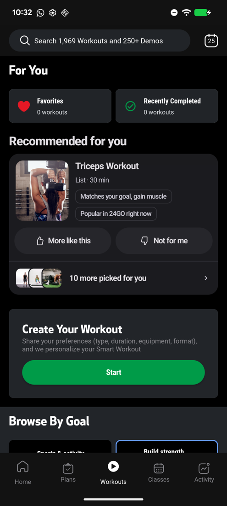
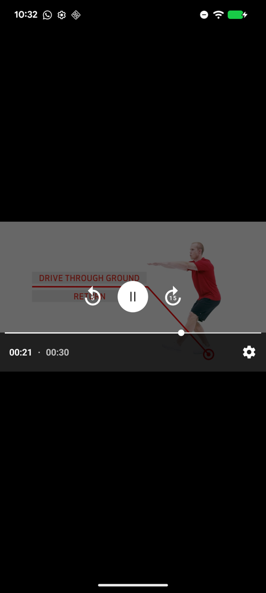

# Eklavya

A voice fitness coach for Android that operates the fitness apps already on
your phone. You talk to it through earphones with the phone on a tripod; it
plans the session, tells you what is next, and can open an exercise's demo
video in your gym's app when you ask.

The name is from the Mahabharata: Eklavya had no access to the teacher he
wanted, so he trained himself in front of a stand-in.

| The app's main screen, where each request starts | The demo page it finds | The demo playing |
| --- | --- | --- |
|  |  |  |

The screens are 24GO's own; Eklavya has no screen yet. This is what it did on
the phone for the request "pistol squat", from the app's log:

```text
22:32:12.2  request: pistol squat
22:32:14.5  went back 2 time(s) to start from the app's main screen
22:32:14.7  tap_1    (1.00)  tap [1] View "search box"
22:32:16.0  type_2   (0.60)  type "pistol squat" into [2] EditText "Search 1,969 Workouts and 250+ Demos"
22:32:16.9  submit_2 (0.91)  press the keyboard's search or enter key in [2] EditText "pistol squat"
22:32:17.9  tap_5    (0.99)  tap [5] CardView "Pistol Squat 1 minutes"
22:32:19.3  tap_16   (0.92)  tap [16] ViewGroup "Start Demo Exercise"
22:32:22.6  done     (1.00)  the task is already complete on this screen
done in 10.3 s, 5 steps, 9,219 tokens, $0.00039
```

## Status

Early. What exists today is the layer everything else stands on: reading
another app's screen, deciding the next step, and acting on it.

| Part | State |
| --- | --- |
| Screen model and text form for a decision model (`screen/`) | Works, tested on the JVM against real 24GO screens |
| Reading and driving screens through an accessibility service (`a11y/`) | Works on a Pixel 7a (Android 16) |
| Navigation by a decision model (`agent/`) | Works on the phone with Jev: see the results below |
| Fixed route through 24GO (`app/`), kept for comparison | Works for exercises 24GO lists under that name |
| Local (on-device) decision model | Supported by the code through any OpenAI-style endpoint; not yet run on the phone |
| Voice, planning, Hevy logging, camera rep counting | Not started |

## Choosing the next step

The navigator first backs out to the app's main screen, so every request
starts from a known place. Then it reads the screen, offers the model every
action that exists on it ("tap [16] Start Demo Exercise", "type the exercise
name into [2]", "scroll [5] down", back, done, stuck) and carries out the one
it picks. The model never writes text or coordinates, so it cannot tap
something that is not there. Three rules sit outside the model:

- Buttons that pay, book, post or unlock are never offered.
- "Done" is offered only after the request has typed or tapped the thing
  asked for, so a video left playing by an earlier request cannot pass as
  the answer.
- Below 40% confidence the navigator stops and says what it was unsure about.

### On the phone

Four requests in a row with Jev on a Pixel 7a over home Wi-Fi, 2026-11-25,
each starting from wherever the previous one ended:

| Request | Result | Time | Steps | Cost |
| --- | --- | --- | --- | --- |
| goblet squat | Played "Kettlebell Goblet Squat" (the first demo listed; 41% confident) | 10.7 s | 5 | $0.00039 |
| lat pulldown | Stopped: 24GO has no demo under that name | 5.2 s | 3 | $0.00026 |
| box squat | Played "Box Squat" | 9.0 s | 5 | $0.00039 |
| pistol squat | Played "Pistol Squat" | 10.3 s | 5 | $0.00039 |

Most of the time is the app itself (page loads and waiting for the screen to
settle); Jev answers each step in about a tenth of a second.

### Models compared

The same fourteen decisions on recorded 24GO screens, asked of three models
from a laptop on 2026-11-25 (`./gradlew :agent:eval`):

| Model | Right | Median time per decision | Cost for all fourteen |
| --- | --- | --- | --- |
| TypeSafe Jev (`jev-latest`) | 13 of 14 | 0.09 s | $0.0009 |
| xAI `grok-4.20-0309-non-reasoning` | 13 of 14 | 0.52 s | $0.0211 |
| OpenAI `gpt-5-nano` | 11 of 14 | 5.6 s | $0.0062 |

Fourteen cases is a small set and this is one run; earlier runs of the same
cases differed by a case or two per model. Jev's one miss came with 23%
confidence, which the navigator treats as "unsure" and does not act on. The
chat models report no confidence. Which model decides is a setting
(`decider`), and any OpenAI-style endpoint works, including a model served on
the phone itself.

## How a screen looks to the model

A 100-node accessibility tree becomes a few numbered lines. Elements hidden
under something drawn on top of them are left out, and icon buttons without
text are named from their view id.

```text
app: io.a24go.android.dev | 1080x2400
[1] ScrollView "detail coordinator" scrollable (540,1227) #detailCoordinator
[2] FrameLayout "Show player controls" clickable (540,446) #detailsVideo
[3] ImageButton "fab back" clickable (73,191) #fabBack
[8] TextView "Barbell Front Squat" clickable (540,961) #detailTitle
[13] TextView "1. Start with Barbell On Shoulders 2. Position Feet Shoulder Width ..." (540,1566)
[14] ViewGroup "Start Demo Exercise" clickable (540,2242) #ctaPrimaryActionView
```

## Modules

- `screen/` is plain Kotlin with no Android classes: `Screen`, `UiNode` and
  `ScreenText`. It can be tested with `adb shell uiautomator dump` files.
- `a11y/` is an Android library: `ScreenReader` copies the accessibility
  windows into a `Screen`, and `ScreenDriver` taps, types, scrolls and waits
  for the screen to settle. Each action finds the live element again first
  and refuses to act if the screen has changed.
- `agent/` is plain Kotlin: `Navigator` works towards a goal one step at a
  time, asking a `Decider` (Jev, or any chat model) to choose among the
  actions on screen. `AppNotes` holds what Eklavya knows about each app.
- `app/` is the Eklavya app: the accessibility service, settings, a fixed
  24GO route kept for comparison, and debug commands for driving the service
  from a computer.

## Build and try

Needs JDK 17 to 21 and the Android SDK (platform 36, build tools 36.0.0).

```bash
./gradlew :screen:test
```

```bash
./gradlew :app:installDebug
```

Turn the service on in Settings → Accessibility → Eklavya. On a sideloaded
install Android greys the switch out until you open the app's info page and
choose "Allow restricted settings" from the ⋮ menu.

Debug builds accept commands from adb (and only from adb):

```bash
adb shell am broadcast -a com.pragnyalabs.eklavya.DEBUG -p com.pragnyalabs.eklavya --es cmd dump
```

```bash
adb shell am broadcast -a com.pragnyalabs.eklavya.DEBUG -p com.pragnyalabs.eklavya --es cmd demo --es arg "squat"
```

```bash
adb logcat -s Eklavya
```

`demo` is the fixed route. `nav` lets the decision model find the way; give
it a key first (the value is stored on the phone and never logged):

```bash
adb shell "am broadcast -a com.pragnyalabs.eklavya.DEBUG -p com.pragnyalabs.eklavya --es cmd set --es arg 'jev_key=YOUR_TYPESAFE_KEY'"
```

```bash
adb shell "am broadcast -a com.pragnyalabs.eklavya.DEBUG -p com.pragnyalabs.eklavya --es cmd nav --es arg 'pistol squat'"
```

## What the app can see

An accessibility service can read everything on screen in every app. Eklavya
reads the screen only while carrying out a request and never copies the
contents of password fields. While the decision model is finding its way, the
text of the app being driven (what is on its screen, including your name if
the app shows it) is sent to the model you chose: TypeSafe by default, or
your own endpoint, which can be a model on the phone. Nothing else leaves the
phone. Release
builds have no remote-control door; the debug commands exist only in debug
builds and only for senders holding Android's `DUMP` permission (adb).

## Licence

MIT. See [NOTICE.md](NOTICE.md) for third-party credits.
